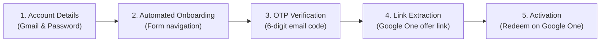

<div align="center">

# Google AI Plus — 1-Year Access Portal

**Automated 12-Month Gemini Advanced & Google AI Plus Offer Link Generator**

[](https://github.com/nmrisrl11)
[](https://microsoft.com/windows)
[](https://python.org)
[](https://playwright.dev)
[](https://customtkinter.tomschimansky.com)
[](#privacy--data-guarantees)

<p align="center">
  A streamlined desktop automation utility engineered to simplify the promotional onboarding and acquisition flow for 12 months of free Google AI Plus (Gemini Advanced and 2TB Google One cloud storage).
</p>

</div>

---

## Table of Contents

- [Overview](#overview)
- [What It Does](#what-it-does)
- [Key Features](#key-features)
- [Tech Stack & Tools](#tech-stack--tools)
- [System Requirements](#system-requirements)
- [Quick Start](#quick-start)
  - [1. Standalone Portable Executable (Recommended)](#1-standalone-portable-executable-recommended)
  - [2. Running from Source (Developer Mode)](#2-running-from-source-developer-mode)
  - [3. Headless CLI Mode](#3-headless-cli-mode)
  - [4. Rebuilding the Portable Executable](#4-rebuilding-the-portable-executable)
- [Step-by-Step Workflow](#step-by-step-workflow)
- [Important Limitations & Expectations](#important-limitations--expectations)
- [Project Architecture](#project-architecture)
- [Account Recovery Tool](#account-recovery-tool)
- [Usage Rules & Responsible Use](#usage-rules--responsible-use)
- [Privacy & Data Guarantees](#privacy--data-guarantees)
- [Disclaimer & Non-Affiliation](#disclaimer--non-affiliation)
- [License](#license)

---

## Overview

Manually claiming educational and student promotional subscriptions typically requires navigating multi-step profile forms, formatting regional contact information, passing email verification gateways, and finding redemption endpoints.

**Google AI Plus Portal** automates the entire navigation, data entry, and registration sequence locally in the background. It prompts the user only when their 6-digit email verification code (OTP) arrives, extracts the official Google One redemption link (`https://one.google.com/offer/...`), and saves the session details safely on your local disk.

---

## What It Does

1. **Profile Generation**: Generates and formats valid demographic student details and regional contact records.
2. **Automated Registration**: Automates browser navigation through the promotional partner onboarding pipeline.
3. **Safe OTP Interception**: Safely prompts for the 6-digit email confirmation code with input sanitization and digit filtering.
4. **Link Extraction**: Navigates to the promotional grant section and captures the unique Google One claim link.
5. **Local Archiving**: Stores credentials, contact details, and the resulting redemption URL into `results/` for future reference.

---

## Key Features

- **Multi-Browser Zero-Bloat Automation**: Intelligent discovery cascade supporting Google Chrome, Microsoft Edge (natively pre-installed on 100% of Windows 10/11 systems), Brave Browser, Opera, or Vivaldi without forcing 400MB hermetic browser downloads.
- **Dynamic Execution Mode**: Operates in full headed visual mode during development, automatically switching to clean background headless execution when packaged as a portable executable.
- **Canonical Link Extraction**: Automatically resolves nested authentication redirections and session tokens, yielding permanent, clean `https://one.google.com/offer/<CODE>` redemption links.
- **Dual Delivery State Handling**: Seamlessly handles direct on-screen offer claims as well as accounts where the promotional grant is dispatched directly to the registered email address.
- **Strict 6-Digit OTP Dialog**: Keystroke-level numeric enforcement, sanitized clipboard pasting, and automatic validation for email codes.
- **Security & CAPTCHA Safety**: Proactively detects Cloudflare Turnstile, interstitials, reCAPTCHA, and server-side challenges, safely stopping to protect accounts from lockouts.
- **Modular Component Architecture**: Separated dialog controllers for About, Voluntary Support, OTP Verification, and Diagnostics.
- **Built-in Diagnostics Suite (<kbd>F12</kbd>)**: Test edge cases (OTP recovery loops, server rejections, and link banners) without consuming Gmail accounts.
- **High-DPI Desktop Branding**: Sharp, anti-aliased multi-resolution icon assets (`16x16` up to `256x256`) with Windows taskbar AppUserModelID integration.

---

## Tech Stack & Tools

| Category | Technology / Tool | Version | Purpose & Implementation |
| :--- | :--- | :--- | :--- |
| **Core Runtime** | **Python** | `3.10 – 3.12` | Application engine, asynchronous queues, and CLI parsing |
| **GUI Framework** | **CustomTkinter** | `6.0.0` | Modern dark-themed user interface, responsive layout & custom modal dialogs |
| **Theme Detection** | **Darkdetect** | `0.8.0` | OS-level light/dark system color scheme detection |
| **Browser Engine** | **Microsoft Playwright** | `1.49+` | Fast multi-browser automation, form synchronization & HTTP/DOM event interception |
| **Session Recovery** | **Chrome DevTools Protocol (CDP)** | Standard | Direct browser context attachment (port 9222) for interrupted session resumption |
| **Native C Compiler** | **Nuitka** | `4.3+` | Python-to-C source code translation yielding tamper-proof native PE binaries |
| **C Backend Toolchain** | **MinGW-w64 GCC** | `15.2.0` | Multi-threaded parallel C compiler (`--jobs=4`) generating x86-64 machine instructions |
| **Compilation Cache** | **ccache** | Built-in | Compiler object cache for sub-2-minute incremental rebuilds |
| **Payload Compression** | **Facebook Zstandard (`zstd`)** | `0.25.0` | High-ratio payload compression (26.3% ratio) reducing binary to `~44.6 MB` with instant startup |
| **Image & Icon Engine** | **Pillow (PIL)** | `11.0+` | Multi-resolution ICO generation (`16x16`–`256x256`), adaptive unsharp masking & donation QR rendering |
| **Windows Shell API** | **Win32 Shell (`ctypes`)** | Native | Explicit `AppUserModelID` registration for proper Windows taskbar grouping and pinning |
| **Fallback Packager** | **PyInstaller** | `6.0+` | Secondary standard bytecode packager fallback (`build_portable.bat`) |

---

## System Requirements

| Component | Requirement |
| :--- | :--- |
| **Operating System** | Windows 10 or Windows 11 (64-bit) |
| **Browser** | Google Chrome, Microsoft Edge (pre-installed), or Brave Browser |
| **Python** *(Source only)* | Python 3.10, 3.11, or 3.12 (Not needed for the portable `.exe`) |
| **Google Account** | A standard personal `@gmail.com` account in good standing |

---

## Quick Start

### 1. Standalone Portable Executable (Recommended)

No installation or technical setup required. Double-click the pre-compiled binary:

```cmd
dist\Google AI Plus Portal v1.0.1.exe
```

- **No Python Required**: Includes all bundled dependencies.
- **Portable & Compact**: Self-contained executable compressed with high-performance Zstandard (`~44.6 MB`).
- **Hardened Security**: Compiled into native x86-64 machine code via Nuitka C translation (tamper-proof; immune to `pyinstxtractor` and Python bytecode decompilers).
- **Silent Background Execution**: Browser automation runs headless in the background.

---

### 2. Running from Source (Developer Mode)

1. Clone or download this repository.
2. Launch via the 1-click launcher:
   ```cmd
   run.bat
   ```
   *(This automatically creates a virtual environment `.venv`, installs dependencies from `requirements.txt`, and boots the GUI).*

Alternatively, run manually via PowerShell / Command Prompt:
```powershell
# Create and activate virtual environment
python -m venv .venv
.\.venv\Scripts\activate

# Install dependencies
pip install -r requirements.txt

# Run application
python main.py
```

---

### 3. Headless CLI Mode

Run without launching the graphical interface:

```powershell
python main.py --cli --email "youraccount@gmail.com" --password "YourSecurePassword123!"
```

*Optional flags:*
- `--first-name "First"`: Specify a custom profile first name.
- `--last-name "Last"`: Specify a custom profile last name.
- `--phone "9876543210"`: Specify a custom 10-digit phone number.
- `--headless`: Run browser automation silently without opening a visual window.

---

### 4. Rebuilding the Portable Executable

You can compile a single-file portable binary from the latest source code using either builder:

#### Option A: Hardened Native C Binary (Recommended — Anti-Reverse Engineering)
Compiles Python directly into native C machine code with GCC and packages it with Zstandard compression (`~44.6 MB`):
- **Via Batch Script**: Double-click [`build_nuitka.bat`](build_nuitka.bat)
- **Via Python**: Run `python build_nuitka.py`

*Benefits: Zero `.pyc` bytecode inside; cannot be unpacked by `pyinstxtractor`.*

#### Option B: Standard Portable Build (PyInstaller Fallback)
Packages Python bytecode into a standard PyInstaller archive (`~61.4 MB`):
- **Via Batch Script**: Double-click [`build_portable.bat`](build_portable.bat)
- **Via Python**: Run `python build_portable.py`

The resulting standalone executable will be written to `dist\Google AI Plus Portal v1.0.1.exe`.

---

## Step-by-Step Workflow



1. **Profile Setup**: Enter your target `@gmail.com` address or click **Randomize Info** to generate fresh placeholder student demographics.
2. **Start Provisioning**: Click **Get 1-Year Access Link**. The system connects to the promotional gateway.
3. **Verify Email**: When prompted by the dialog, enter the 6-digit verification code received in your Gmail inbox.
4. **Copy Offer Link or Email Access**: Once extracted, your unique Google One promotional redemption URL appears on screen in canonical format (`https://one.google.com/offer/<CODE>`). If the partner dispatches the grant directly via email, clear in-app guidance will direct you to the activation message in your inbox.
5. **Redeem on Google**: Click **Copy Offer Link** or **Open in Browser** to complete activation directly on your Google account. Both credentials and links are safely saved to the `results/` folder.

---

## Important Limitations & Expectations

> [!IMPORTANT]
> Please review these technical constraints before running the provisioner:

1. **Google Account Eligibility**:
   - The destination Google account must be a standard personal account in good standing.
   - Accounts currently enrolled in conflicting Google Workspace / G Suite business domains or active paid Google One memberships may need to cancel existing plans before promotional grants can apply.
2. **Payment Method Linking on Google One**:
   - Activating a promotional subscription on Google One requires linking a valid payment method (Credit/Debit Card, PayPal, etc.) to verify identity and enable post-trial renewals.
   - **$0.00 is billed today** for the 12-month promotional period. Auto-renewal can be managed or canceled anytime via Google One subscription settings.
3. **Single-Use Promotional Grant**:
   - Each extracted redemption link is single-use and bound to the registration session. Once redeemed, it cannot be transferred to another Google account.
4. **Third-Party Availability**:
   - Promotional grant quotas, regional availability, and gateway validation rules are maintained by third-party educational partners and Google, and are subject to change.

---

## Project Architecture

```text
gemini-ai-plus-claimer/
├── constants.py                     # Version, dynamic environment detection & paths
├── claimer.py                       # Playwright browser engine & error normalization
├── gui.py                           # CustomTkinter UI with high-DPI taskbar mipmaps
├── main.py                          # Dual GUI/CLI entry point with AppUserModelID
├── convert_icon.py                  # Multi-resolution ICO & transparent PNG generator
├── build_nuitka.bat                 # 1-click hardened native C compiler (Nuitka + Zstd)
├── build_nuitka.py                  # Scripted native C builder (tamper-proof binary)
├── build_portable.bat               # 1-click fallback portable compiler (PyInstaller)
├── build_portable.py                # Scripted PyInstaller builder
├── run.bat                          # 1-click Windows source launcher
├── requirements.txt                 # Python dependencies
├── README.md                        # Documentation
├── AGENT.md                         # Architecture blueprint & handoff guide
├── images/                          # High-DPI icons, logos, and donation QRs
│   ├── app_icon.ico                 # Multi-layer sharpened icon (16x16 to 256x256)
│   ├── app_icon.png                 # 512x512 transparent PNG
│   ├── qrcode-bmc.png               # Buy Me a Coffee QR
│   ├── qrcode-gcash.JPG             # GCash QR
│   └── shuffle.png                  # Randomize button icon
├── dialogs/                         # Modular dialog controllers
│   ├── __init__.py                  # Modal exports
│   ├── about_modal.py               # About, expectations & privacy dialog (F1)
│   ├── diagnostics_modal.py         # Developer edge case testing suite (F12)
│   ├── otp_dialog.py                # 6-digit keystroke-validated OTP dialog
│   └── support_modal.py             # Voluntary donation modal
├── account_recovery/                # CDP live browser session recovery tool
│   ├── README.md                    # Recovery instructions
│   ├── resume_browser_session.py    # CDP session attach script
│   └── run_account_recovery.bat     # 1-click recovery launcher
├── results/                         # Local storage for saved credentials & claim links
└── dist/                            # Production output
    └── Google AI Plus Portal v1.0.1.exe  # Hardened native standalone binary (44.6 MB)
```

---

## Account Recovery Tool

If a registration was completed manually or was interrupted midway by a security challenge, you do not need to start over:

```cmd
cd account_recovery
run_account_recovery.bat
```

This utility connects directly to an active browser instance (Chrome, Brave, or Edge) via Chrome DevTools Protocol (CDP), resumes the authenticated session, and extracts the final redemption link without re-entering credentials.

---

## Usage Rules & Responsible Use

To ensure fair usage and prevent infrastructure abuse:

1. **Personal Utility**: Designed strictly for individual, personal, and educational use to simplify manual onboarding flows.
2. **No Rate Abuse**: Automated bulk creation, link farming, or high-concurrency requests are discouraged and subject to rate limits and upstream verification stops.
3. **Accuracy of Data**: Use valid email accounts under your direct control to ensure successful OTP verification.

---

## Privacy & Data Guarantees

- **100% Local Execution**: All automation routines run entirely on your local computer. No cloud relays, third-party proxies, or external servers are involved.
- **Zero Telemetry**: Contains no analytics, trackers, user tracking, or telemetry reporting.
- **Local Credential Storage**: Passwords, email addresses, and generated links are stored strictly in the local `results/` folder on your machine and are never transmitted to the developer.

---

## Disclaimer & Non-Affiliation

This project is an independent desktop utility provided for convenience, testing, and educational purposes.

- This software is **NOT affiliated with, sponsored by, or endorsed by Google LLC, Alphabet Inc., or Internshala**.
- Google, Google AI, Google One, and Gemini are registered trademarks of Google LLC.
- Internshala is a registered trademark of Scholiverse Educare Private Limited.
- All product and company names are trademarks or registered trademarks of their respective holders.

---

## License

Copyright (c) 2026 nmrisrl11. All rights reserved.

This is a private proprietary utility. Unauthorized commercial redistribution, re-packaging, or public mirror hosting without prior written consent is strictly prohibited.
